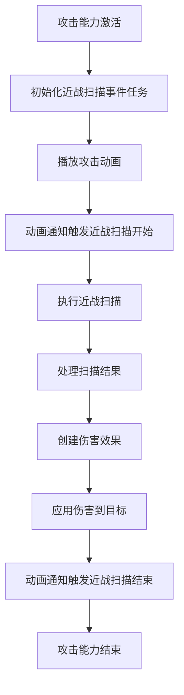

# 人物近战打击流程分析

## 流程概述

Ninja Combat 插件中的人物近战打击流程是一个复杂的事件驱动系统，涉及多个组件和步骤的协同工作。以下是从激活攻击能力到成功打击目标的完整流程：

## 详细流程

### 1. 攻击能力激活

**触发条件**：玩家输入攻击指令或AI决策执行攻击

**执行步骤**：
1. 玩家输入触发攻击能力
2. 系统调用 `UCombatAbility_Attack::ActivateAbility` 方法
3. 方法初始化近战扫描事件任务 `MeleeScanEventTask`
4. 任务开始监听 `Tag_Combat_Event_MeleeScan` 相关事件

**关键代码**：
```cpp
void UCombatAbility_Attack::ActivateAbility(const FGameplayAbilitySpecHandle Handle,
    const FGameplayAbilityActorInfo* ActorInfo, const FGameplayAbilityActivationInfo ActivationInfo,
    const FGameplayEventData* TriggerEventData)
{
    Super::ActivateAbility(Handle, ActorInfo, ActivationInfo, TriggerEventData);

    if (bIsMeleeAttack)
    {
        static constexpr bool bExactOnly = false;
        MeleeScanEventTask = InitializeEventTask(Tag_Combat_Event_MeleeScan, bExactOnly);
        MeleeScanEventTask->ReadyForActivation();
    }
    // 远程攻击代码...
}
```

### 2. 动画事件触发

**触发条件**：攻击动画播放到特定帧

**执行步骤**：
1. 攻击能力激活后，播放攻击动画
2. 动画中的通知（如 `AnimNotify_StartMeleeScan`）触发
3. 通知发送 `Tag_Combat_Event_MeleeScan_Start` 事件
4. 事件携带 `UNinjaCombatMeleeScan` 对象作为参数

### 3. 近战扫描初始化

**触发条件**：接收到 `Tag_Combat_Event_MeleeScan_Start` 事件

**执行步骤**：
1. `UCombatAbility_Attack::HandleEventReceived_Implementation` 方法接收事件
2. 方法从事件数据中提取 `UNinjaCombatMeleeScan` 对象
3. 检查扫描数据是否有效
4. 初始化或更新 `MeleeScanTask` 任务
5. 激活扫描任务

**关键代码**：
```cpp
void UCombatAbility_Attack::HandleEventReceived_Implementation(const FGameplayEventData Payload)
{
    Super::HandleEventReceived_Implementation(Payload);
    
    if (bIsMeleeAttack)
    {
        if (Payload.EventTag == Tag_Combat_Event_MeleeScan_Start)
        {
            const UNinjaCombatMeleeScan* Scan = Cast<UNinjaCombatMeleeScan>(Payload.OptionalObject);
            if (ensureMsgf(IsValid(Scan) && Scan->HasValidScanData(), TEXT("Missing or invalid Melee Scan.")))
            {
                if (IsValid(MeleeScanTask) && MeleeScanTask->IsActive())
                {
                    MeleeScanTask->Join(Scan);	
                }
                else
                {
                    FinishLatentTask(MeleeScanTask);
                    MeleeScanTask = InitializeMeleeScanTask(Scan);
                    MeleeScanTask->ReadyForActivation();
                }
            }
        }
        // 其他事件处理...
    }
    // 远程攻击事件处理...
}
```

### 4. 执行近战扫描

**触发条件**：`MeleeScanTask` 任务激活

**执行步骤**：
1. `UAbilityTask_ScanMeleeTarget` 任务开始执行
2. 根据 `UNinjaCombatMeleeScan` 中的参数执行扫描
3. 扫描检测范围内的所有潜在目标
4. 对每个目标进行有效性检查（如是否可攻击、是否在视线内等）
5. 收集所有有效的命中结果

### 5. 处理扫描结果

**触发条件**：近战扫描完成并找到目标

**执行步骤**：
1. 扫描任务调用 `HandleMeleeScanTargetsReceived` 方法
2. 方法遍历所有命中结果
3. 对每个命中结果创建伤害效果规格
4. 将伤害效果应用到命中的目标

**关键代码**：
```cpp
void UCombatAbility_Attack::HandleMeleeScanTargetsReceived_Implementation(const UNinjaCombatMeleeScan* MeleeScan, 
    const FGameplayAbilityTargetDataHandle& Data)
{
    for (int32 Idx = 0; Idx < Data.Num(); ++Idx)
    {
        const FHitResult* HitResult = Data.Get(Idx)->GetHitResult();
        if (HitResult != nullptr)
        {
            TObjectPtr<AActor> Target = HitResult->GetActor();
            if (IsValid(Target))
            {
                FGameplayEffectSpecHandle SpecHandle;
                if (CreateSpecHandleForMeleeHit(MeleeScan, SpecHandle) && SpecHandle.IsValid())
                {
                    ApplyGameplayEffectSpecToHitResult(SpecHandle, *HitResult);
                }
            }
        }
    }	
}
```

### 6. 创建伤害效果

**触发条件**：处理扫描结果时需要对目标造成伤害

**执行步骤**：
1. 调用 `CreateSpecHandleForMeleeHit` 方法
2. 方法获取伤害源的游戏效果类
3. 获取游戏效果等级
4. 创建游戏效果规格
5. 添加攻击者和伤害源信息
6. 应用伤害值和连击计数器

**关键代码**：
```cpp
bool UCombatAbility_Attack::CreateSpecHandleForMeleeHit(const UNinjaCombatMeleeScan* MeleeScan, FGameplayEffectSpecHandle& OutHandle) const
{
    if (ensure(IsValid(MeleeScan)))
    {
        AActor* EffectCauser = MeleeScan->GetCauser();
        if (IsValid(EffectCauser))
        {
            const TSubclassOf<UGameplayEffect> HitEffect = GetMeleeGameplayEffectClass(EffectCauser);
            const float EffectLevel = GetMeleeGameplayEffectLevel(EffectCauser);

            if (IsValid(HitEffect))
            {
                OutHandle = MakeOutgoingGameplayEffectSpec(HitEffect, EffectLevel);
                if (OutHandle.IsValid())
                {
                    OutHandle.Data.Get()->GetContext().AddInstigator(GetAvatarActorFromActorInfo(), EffectCauser);
                    ApplyDamageValues(EffectCauser, OutHandle);
                    return true;
                }
            }
        }
    }

    return false;	
}
```

### 7. 应用伤害效果

**触发条件**：创建伤害效果规格后

**执行步骤**：
1. 调用 `ApplyGameplayEffectSpecToHitResult` 方法
2. 方法从命中结果创建目标数据
3. 应用游戏效果到目标
4. 返回应用效果的句柄数组

**关键代码**：
```cpp
TArray<FActiveGameplayEffectHandle> UCombatAbility_Attack::ApplyGameplayEffectSpecToHitResult(
    const FGameplayEffectSpecHandle& SpecHandle, const FHitResult& HitResult)
{
    FGameplayAbilityTargetingLocationInfo TargetInfo;
    TargetInfo.LocationType = EGameplayAbilityTargetingLocationType::ActorTransform;
    TargetInfo.SourceActor = GetAvatarActorFromActorInfo();
    TargetInfo.SourceAbility = this;

    const FGameplayAbilityTargetDataHandle TargetData = TargetInfo.MakeTargetDataHandleFromHitResult(this, HitResult);
    return ApplyGameplayEffectSpecToTarget(GetCurrentAbilitySpecHandle(), GetCurrentActorInfo(), GetCurrentActivationInfo(), SpecHandle, TargetData);	
}
```

### 8. 近战扫描结束

**触发条件**：攻击动画播放到结束帧或达到扫描时间限制

**执行步骤**：
1. 动画中的通知触发 `Tag_Combat_Event_MeleeScan_Stop` 事件
2. 系统调用 `HandleEventReceived_Implementation` 方法
3. 方法结束近战扫描任务 `MeleeScanTask`

**关键代码**：
```cpp
else if (Payload.EventTag == Tag_Combat_Event_MeleeScan_Stop)
{
    FinishLatentTask(MeleeScanTask);
}
```

### 9. 攻击能力结束

**触发条件**：攻击动画完成或被中断

**执行步骤**：
1. 系统调用 `UCombatAbility_Attack::EndAbility` 方法
2. 方法结束所有相关任务
3. 调用父类的 `EndAbility` 方法

**关键代码**：
```cpp
void UCombatAbility_Attack::EndAbility(const FGameplayAbilitySpecHandle Handle,
    const FGameplayAbilityActorInfo* ActorInfo, const FGameplayAbilityActivationInfo ActivationInfo,
    const bool bReplicateEndAbility, const bool bWasCancelled)
{
    FinishLatentTasks({ MeleeScanEventTask, LaunchProjectileEventTask, MeleeScanTask, SpawnProjectileTask });	
    Super::EndAbility(Handle, ActorInfo, ActivationInfo, bReplicateEndAbility, bWasCancelled);
}
```

## 流程图



## 核心组件交互

| 组件 | 职责 | 关键方法 |
|------|------|----------|
| UCombatAbility_Attack | 管理攻击能力生命周期 | ActivateAbility, HandleEventReceived_Implementation |
| UAbilityTask_ScanMeleeTarget | 执行近战扫描 | Join, ReadyForActivation |
| UNinjaCombatMeleeScan | 存储扫描参数 | GetCauser, HasValidScanData |
| UGameplayEffect | 应用伤害效果 | MakeOutgoingGameplayEffectSpec |
| UNinjaCombatComboManagerComponent | 管理连击计数 | GetComboCount |

## 技术特点

1. **事件驱动**：整个流程基于事件系统，由动画通知触发关键步骤
2. **模块化设计**：将攻击能力、扫描任务、伤害应用等功能分离
3. **可扩展性**：通过接口和蓝图可重写方法支持自定义行为
4. **网络同步**：支持网络环境下的攻击同步
5. **连击系统**：集成连击计数器，支持基于连击数的伤害变化

## 代码优化建议

1. **性能优化**：
   - 考虑为频繁使用的游戏效果规格添加缓存机制
   - 优化近战扫描的检测算法，减少不必要的计算

2. **可维护性**：
   - 增加更多的日志记录，便于调试复杂的近战流程
   - 考虑将近战扫描的参数配置外部化，通过数据资产管理

3. **功能增强**：
   - 添加命中反馈系统，如命中特效和音效
   - 实现更复杂的近战判定，如部位伤害和暴击系统

## 输入输出示例

#### 输入输出示例

**输入**：
```cpp
// 玩家输入触发攻击
PlayerController->InputComponent->BindAction("Attack", IE_Pressed, this, &AMyCharacter::HandleAttackInput);

// 攻击输入处理
void AMyCharacter::HandleAttackInput()
{
    ULyraAbilitySystemComponent* ASC = GetLyraAbilitySystemComponent();
    if (ASC)
    {
        ASC->TryActivateAbilityByTag(FGameplayTag::RequestGameplayTag("Combat.Ability.Attack"));
    }
}
```

**输出**：
```
// 控制台输出
LogNinjaCombat: Verbose: Activating attack ability for character MyCharacter_0
LogNinjaCombat: Verbose: Initializing melee scan task with radius 150.0, angle 90.0
LogNinjaCombat: Verbose: Melee scan found 2 targets
LogNinjaCombat: Verbose: Applying damage effect to Target_1 with value 25.0
LogNinjaCombat: Verbose: Applying damage effect to Target_2 with value 25.0
LogNinjaCombat: Verbose: Attack ability ended successfully
```

## 总结

Ninja Combat 插件的近战打击流程是一个设计精巧的事件驱动系统，通过多个组件的协同工作实现了从攻击激活到目标伤害的完整过程。这种模块化、事件驱动的设计不仅使得代码结构清晰，而且具有高度的可扩展性和可定制性。

该流程的核心优势在于：
1. **精确的时间控制**：通过动画通知实现攻击动作与扫描时机的精确同步
2. **灵活的伤害系统**：支持基于连击数和伤害源的伤害计算
3. **强大的扩展性**：通过蓝图可重写方法和接口支持自定义行为
4. **网络友好**：设计考虑了网络环境下的同步需求

这种设计为游戏开发者提供了一个强大而灵活的近战战斗系统基础，可以根据具体游戏需求进行定制和扩展。